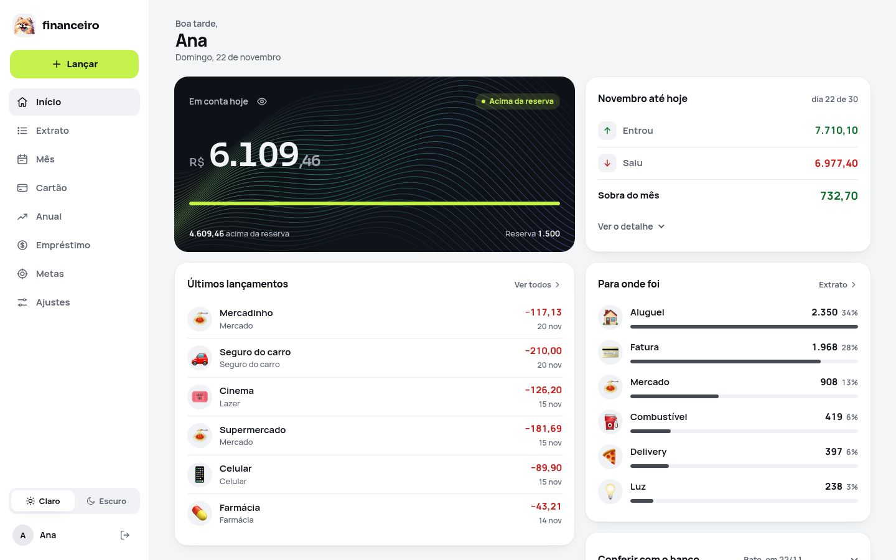

<div align="center">


# Financeiro

**Track your household money on your own server: add expenses in seconds, see how the month will end, and plan purchases, debts and investments.**

No subscription, no cloud, and it never asks for your bank password.

  

[Português](README.md)

<br>

<picture>
  <source media="(prefers-color-scheme: dark)" srcset="docs/img/pc-inicio-escuro.jpg">
  
</picture>

<sub>All screenshots use made-up data from the demo mode. The app also runs in English and Spanish; the screenshots are in Portuguese.</sub>

</div>

## What it does

- **See your account's future:** month by month, see how much you will have and try "what if" without saving anything.
- **Find the best month to buy:** paste a product link, in any currency, and the app shows when the purchase fits your plan.
- **Find out if paying a loan early is worth it:** type an amount and see what is left, when it ends and how much interest you save.
- **Know your next card bills:** add installment purchases and see each bill before it arrives.
- **Get a report that explains your month:** download a PDF, by month or year, with charts, what went well, what went badly and what can improve.
- **Pick your look:** 32 themes with preview, including high-contrast and color-blind options.

## Install

On a computer with Ubuntu 24.04 or newer, run:

```sh
git clone https://github.com/HunterBDZ/Financeiro.git
sudo bash Financeiro/instalar.sh
```

Wait a few minutes: no questions are asked. At the end, open the address shown and create your account in the browser.

Your browser will warn that the connection is not secure the first time, because the certificate is self-signed. The app is made for your home network: to reach it from outside, use a VPN, without opening router ports.

## Update

Sites do not update themselves. One command downloads the latest published version, tests it on a copy of the database, backs up and applies it. If something fails, the site goes back to the previous version.

```sh
sudo financeiro-atualizar --verificar   # is there a new version? what changes?
sudo financeiro-atualizar               # update
```

## Documentation

The detailed documentation is in Portuguese:

- [Installation manual](docs/INSTALACAO.md)
- [Inside the app](docs/POR-DENTRO.md)
- [Security](docs/SEGURANCA.md), including what leaves the server
- [Decisions](docs/decisoes.md)
- [Contributing](CONTRIBUTING.md) and [reporting a vulnerability](SECURITY.md)

## License

© 2026 Hunter. Released under the [AGPL-3.0-or-later](LICENSE).

Third-party components: Manrope, Sora and JetBrains Mono fonts under the OFL and Noto Emoji icons under Apache-2.0. See the [third-party notices](THIRD_PARTY_NOTICES.md).
