<div align="center">


# Financeiro

**Controle o dinheiro da sua casa no seu próprio servidor: lance gastos em segundos, veja como o mês vai fechar e planeje compras, dívidas e investimentos.**

Sem assinatura, sem nuvem e sem pedir a senha do seu banco.

[](CHANGELOG.md)   

[Diferenciais](#diferenciais) · [Telas](#telas) · [Como funciona](#como-funciona) · [Instalar](#instalar) · [Atualizar](#atualizar) · [Documentação](#documentação)

<br>

<picture>
  <source media="(prefers-color-scheme: dark)" srcset="docs/img/pc-inicio-escuro.jpg">
  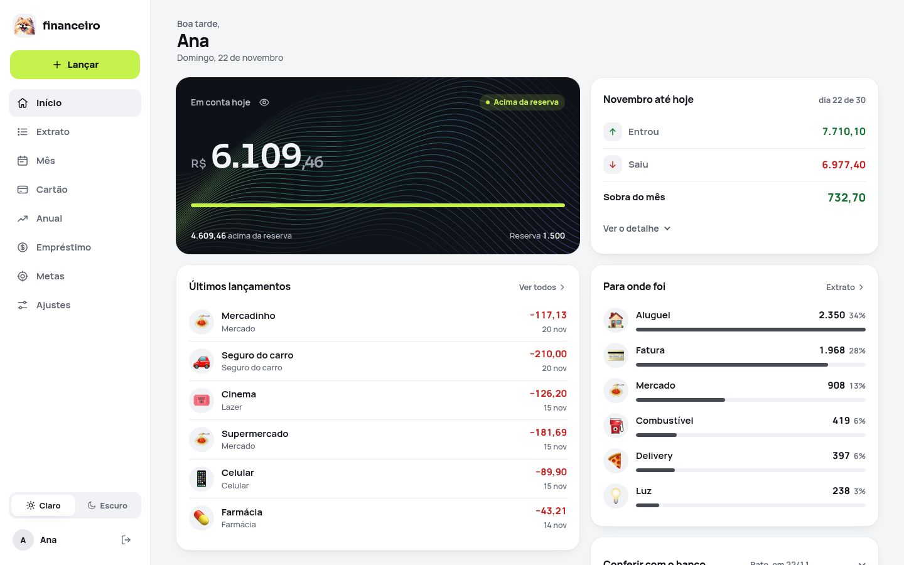
</picture>

<sub>Todos os prints usam dados fictícios do modo de demonstração.</sub>

</div>

## Diferenciais

### Veja o futuro da sua conta

Mês a mês, veja quanto terá na conta e teste "e se" sem salvar nada.

<picture>
  <source media="(prefers-color-scheme: dark)" srcset="docs/img/pc-futuro-escuro.jpg">
  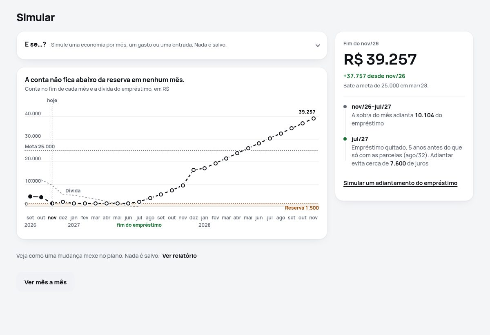
</picture>

### Saiba o melhor mês para comprar

Cole o link do que quer comprar, em qualquer moeda, e o app indica quando a compra cabe no seu plano.

<picture>
  <source media="(prefers-color-scheme: dark)" srcset="docs/img/pc-wishlist-escuro.jpg">
  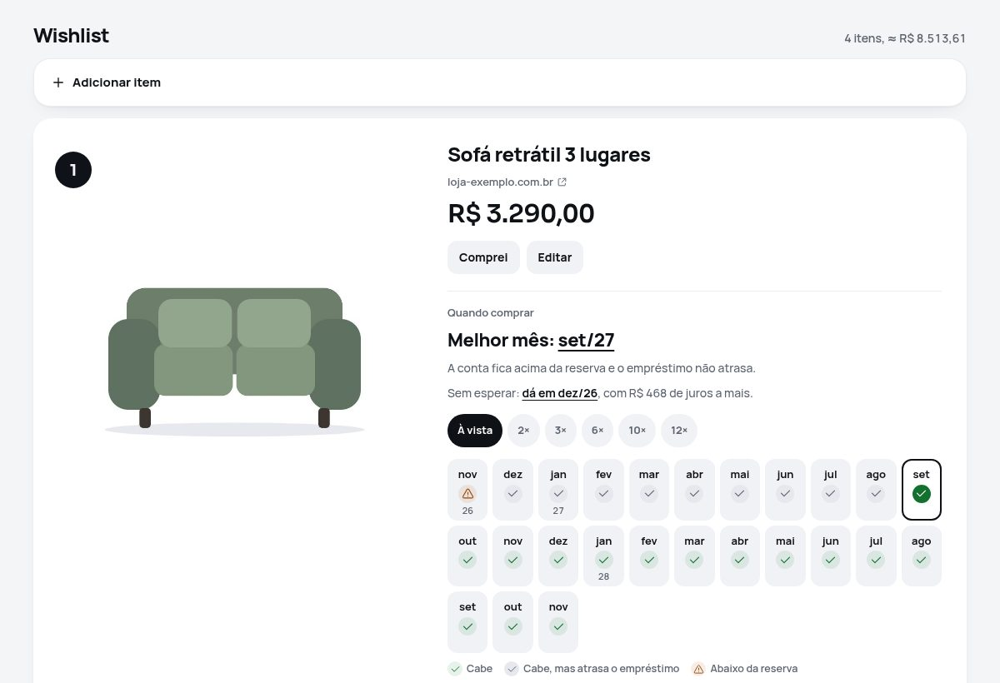
</picture>

### Descubra se vale adiantar o empréstimo

Digite um valor e veja quanto falta, quando termina e quanto de juros você deixa de pagar.

<picture>
  <source media="(prefers-color-scheme: dark)" srcset="docs/img/pc-emprestimo-escuro.jpg">
  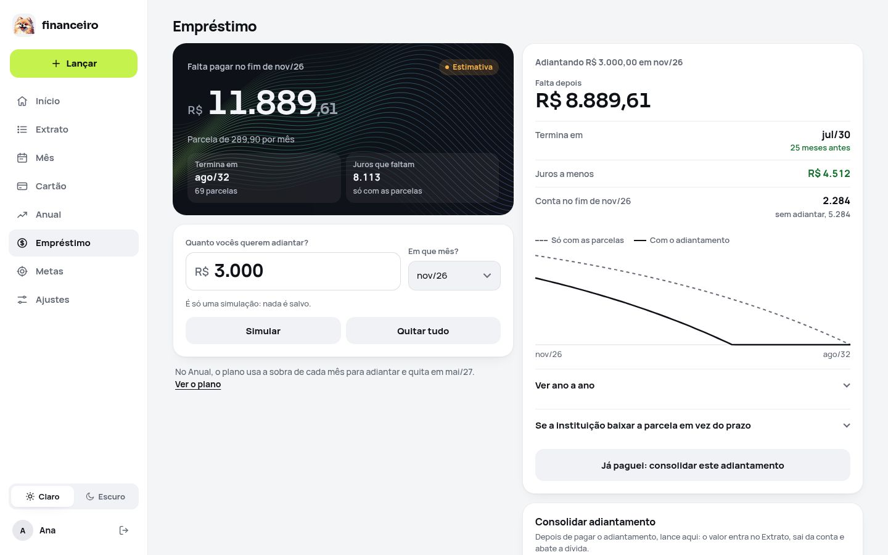
</picture>

### Saiba quanto vem nas próximas faturas

Lance compras parceladas e veja o valor de cada fatura antes de ela chegar.

<picture>
  <source media="(prefers-color-scheme: dark)" srcset="docs/img/pc-cartao-escuro.jpg">
  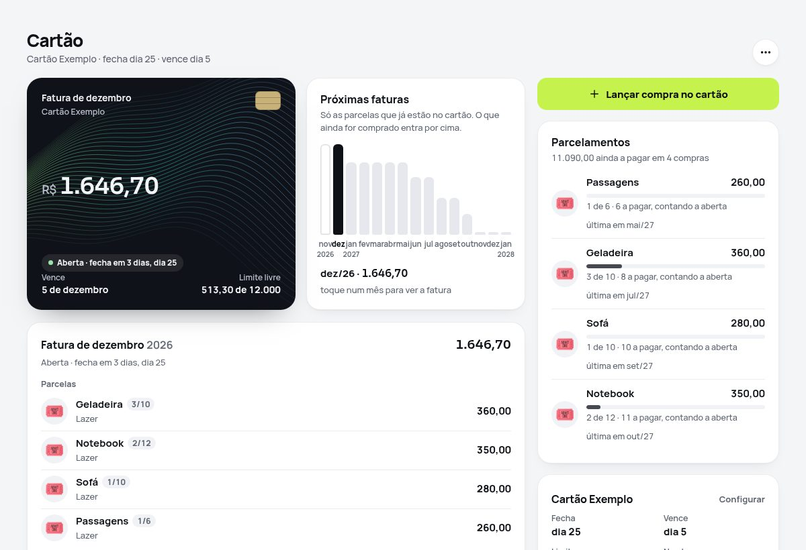
</picture>

### Receba um relatório que explica seu mês

Baixe em PDF, por mês ou por ano, com gráficos, o que foi bom, o que foi ruim e o que pode melhorar.

<picture>
  <source media="(prefers-color-scheme: dark)" srcset="docs/img/pc-relatorio-escuro.jpg">
  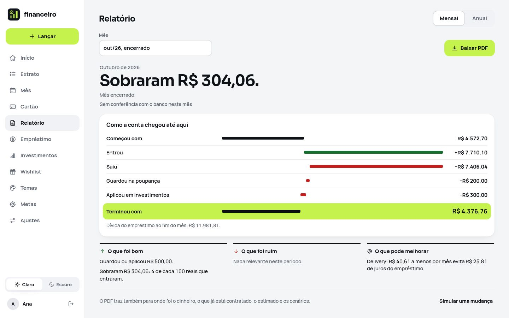
</picture>

### Escolha a cara do seu app

São 32 temas com prévia, incluindo opções de alto contraste e para daltonismo.

<picture>
  <source media="(prefers-color-scheme: dark)" srcset="docs/img/pc-temas-escuro.jpg">
  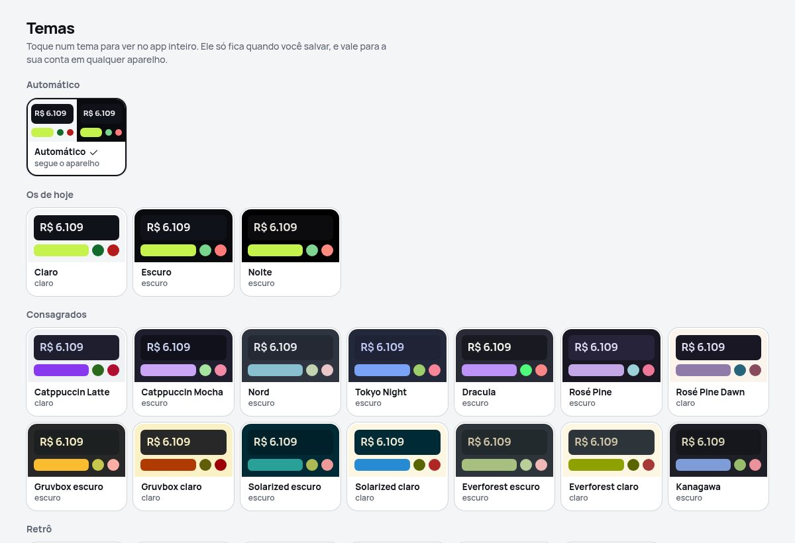
</picture>

## Telas

Funciona no computador e no celular.

<picture>
  <source media="(prefers-color-scheme: dark)" srcset="docs/img/pc-mes-escuro.jpg">
  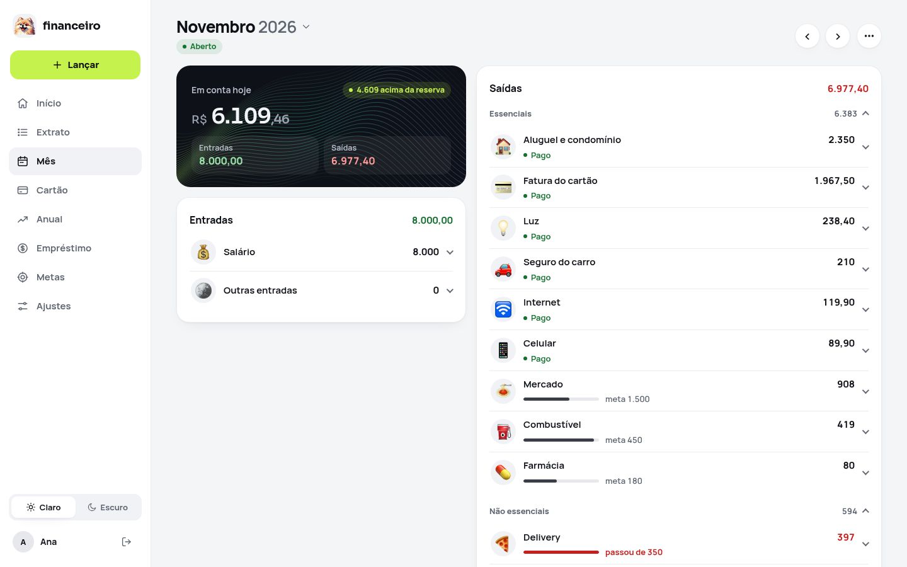
</picture>

<table>
  <tr>
    <td align="center">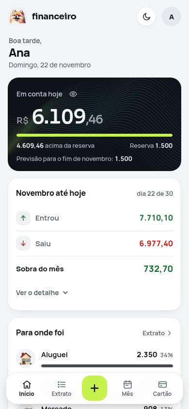<br><b>Início</b></td>
    <td align="center">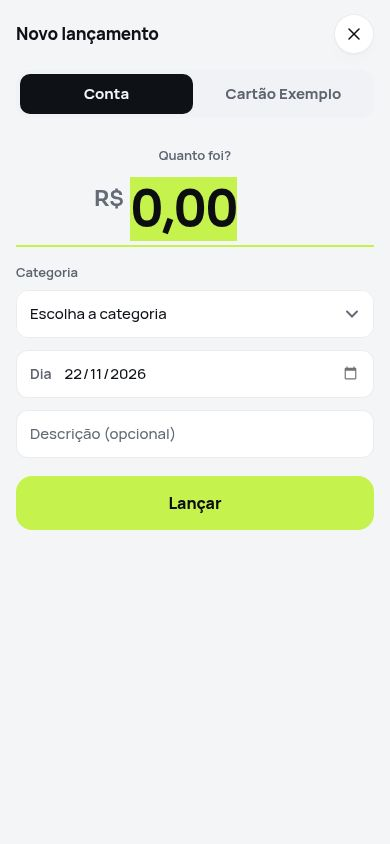<br><b>Lançar</b></td>
    <td align="center">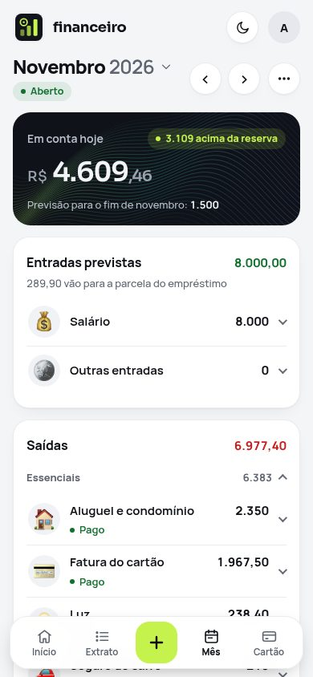<br><b>Mês</b></td>
  </tr>
</table>

## Como funciona

1. **Comece.** Crie a sua conta e informe a data de início e quanto você tem hoje.
2. **Lance.** Aperte **Lançar**, digite o valor e escolha a categoria.
3. **Acompanhe.** Abra **Mês** para ver como ele deve terminar.
4. **Feche.** No fim do mês, confira o saldo com o banco e feche o mês.

## Instalar

Em um computador com Ubuntu 24.04 ou mais novo, rode:

```sh
git clone git@github.com:HunterBDZ/Financeiro.git
sudo bash Financeiro/instalar.sh
```

Espere alguns minutos: nenhuma pergunta é feita. No fim, abra o endereço que aparecer e crie a sua conta no navegador.

Dúvidas? Veja o [manual de instalação](docs/INSTALACAO.md).

## Atualizar

Os sites não se atualizam sozinhos: o dono decide quando. Um comando baixa a última versão publicada, testa numa cópia do banco, faz backup e aplica. Se algo falhar, o site volta para a versão anterior.

```sh
sudo financeiro-atualizar --verificar   # há versão nova? o que muda?
sudo financeiro-atualizar               # atualiza
```

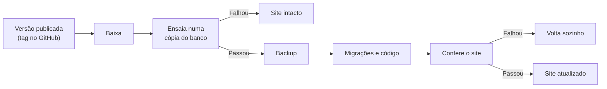

As mudanças de cada versão ficam no [`CHANGELOG.md`](CHANGELOG.md).

## Documentação

- **[Manual de instalação](docs/INSTALACAO.md):** instalar, atualizar, restaurar e resolver problemas.
- **[Por dentro](docs/POR-DENTRO.md):** arquitetura, pastas, testes e acessibilidade.
- **[Segurança](docs/SEGURANCA.md):** como o app protege contas e dados.
- **[Como lançar uma versão](docs/LANCAR-VERSAO.md):** para quem desenvolve.
- **[Decisões e operação](docs/decisoes.md):** o porquê de cada regra.

## Status e licença

**Status:** em desenvolvimento ativo. As mudanças de cada versão estão no [`CHANGELOG.md`](CHANGELOG.md).

**Licença:** © 2026 [HunterBDZ](https://github.com/HunterBDZ). Todos os direitos reservados.

**Componentes de terceiros:** fontes Manrope e Sora sob licença OFL. Veja os créditos dos [temas](tools/temas/CREDITOS.md) e dos [ícones](tools/icones/CREDITOS.md).
