<div align="center">


# Financeiro

**O controle financeiro da casa, no seu servidor: lance em segundos, veja como o mês fecha e planeje a quitação do empréstimo.**

[](CHANGELOG.md)    

[Diferenciais](#o-que-ele-tem-de-diferente) · [Telas](#telas) · [Como funciona](#como-funciona) · [Instalar](#instalar) · [Atualizar](#atualizar) · [Manual completo](docs/INSTALACAO.md)

<br>

<picture>
  <source media="(prefers-color-scheme: dark)" srcset="docs/img/pc-inicio-escuro.jpg">
  
</picture>

<sub>Todos os prints usam dados fictícios do modo de demonstração.</sub>

</div>

## Por que existe

O Financeiro nasceu para substituir uma planilha que um casal usava para controlar a conta conjunta, o cartão e um empréstimo consignado. Planilha responde o que já aconteceu, mas dá trabalho no celular e pouco ajuda a decidir.

Aqui, os dois lançam pelo celular, e o app responde o que importa: **quanto tem na conta, como o mês vai fechar e o que acontece se adiantarmos o empréstimo**. Tudo fica num servidor seu, sem assinatura, sem nuvem e sem compartilhar a senha do banco.

## O que ele tem de diferente

| Diferencial | O que significa |
|---|---|
| **Olha para a frente** | Projeta a conta e a dívida mês a mês, avisa quando um mês vai ficar abaixo da reserva e simula "e se" sem gravar nada. |
| **O mês reage aos lançamentos** | Num mês aberto, cada categoria conta pelo maior valor entre o gasto e o previsto: o que passou aparece na hora, e o que falta gastar continua reservado. |
| **Meta vira previsão** | A meta de uma categoria vale para todos os meses em aberto. Ajustou um mês? Só ele vira exceção, com desfazer. |
| **Empréstimo de verdade** | Simule um adiantamento e veja quanto falta, quando termina, os juros a menos e o efeito na conta. Depois de pagar, lance no Extrato com um toque. |
| **Wishlist que responde quando** | Cole o link do que querem comprar, em real ou outra moeda. O app simula a compra em cada mês do plano e diz o melhor mês, sem furar a reserva nem atrasar o empréstimo. |
| **Cartão pelo que importa** | Compras e parcelas formam a escada das próximas faturas. No plano só conta a fatura, no mês em que vence, sem contar o gasto duas vezes. |
| **Contas que não enganam** | Empréstimo e poupança nunca contam como renda ou gasto, e dá para conferir o saldo com o banco a qualquer momento. |
| **Feito para duas pessoas** | Cada um tem seu login, e o app guarda quem lançou o quê, com aviso de lançamento duplicado e desfazer. |
| **32 temas, cada um com o seu** | Do Nord ao Terminal, passando por paletas brasileiras e opções de acessibilidade. Cada card mostra a prévia, e o tema escolhido acompanha a conta em qualquer aparelho. |
| **Seu servidor, seus dados** | Roda em PHP e MySQL, na sua rede. Não tem Composer, npm nem etapa de build: atualizar é copiar arquivos. |

## Telas

<table>
  <tr>
    <td align="center"><br><b>Lançar</b><br><sub>Valor primeiro, conta ou cartão</sub></td>
    <td align="center"><br><b>Mês</b><br><sub>Previsão editável, contas e metas</sub></td>
    <td align="center">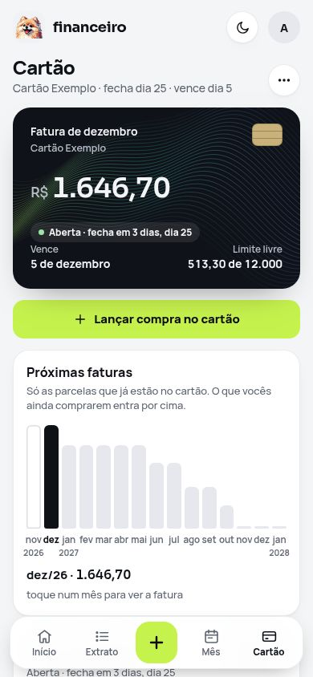<br><b>Cartão</b><br><sub>Fatura aberta e as próximas</sub></td>
    <td align="center">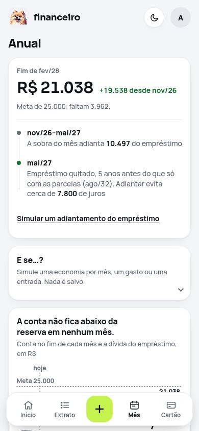<br><b>Anual</b><br><sub>Projeção e "E se…?"</sub></td>
  </tr>
  <tr>
    <td align="center">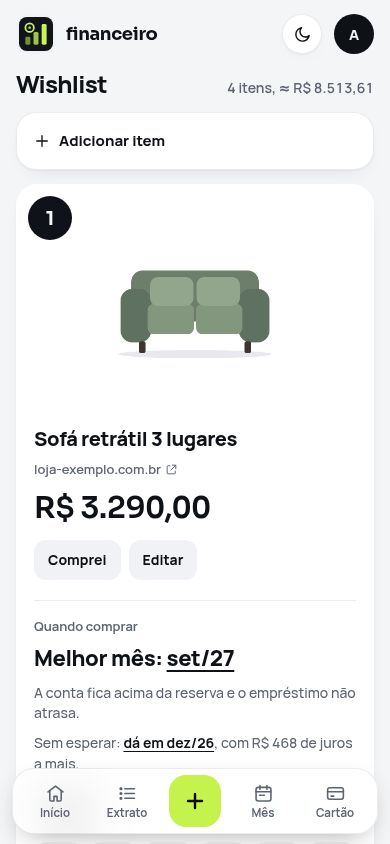<br><b>Wishlist</b><br><sub>Link, foto, valor e ordem</sub></td>
    <td align="center">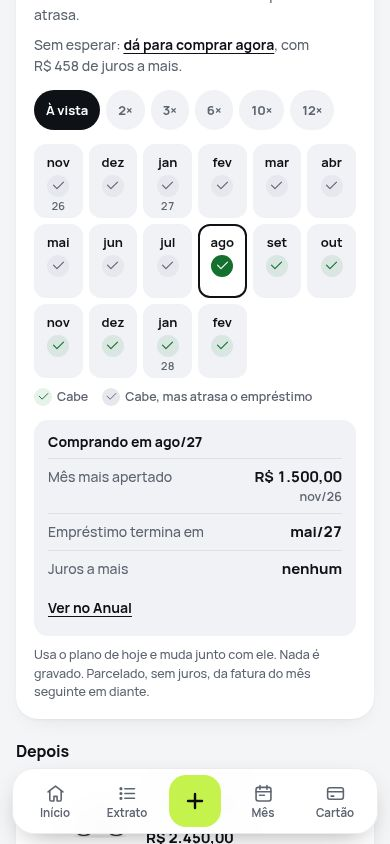<br><b>Quando comprar</b><br><sub>Mês a mês, à vista ou parcelado</sub></td>
    <td align="center">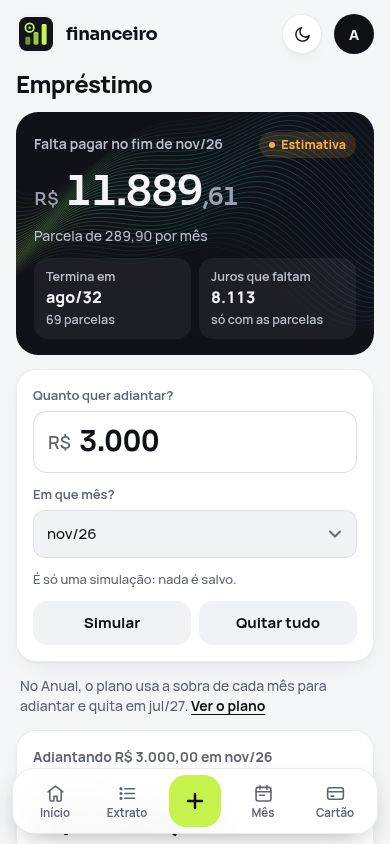<br><b>Empréstimo</b><br><sub>Simular e consolidar</sub></td>
    <td align="center">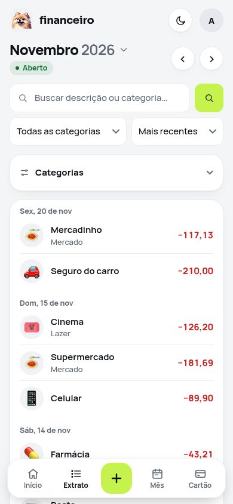<br><b>Extrato</b><br><sub>O que foi lançado, e por quem</sub></td>
  </tr>
  <tr>
    <td align="center">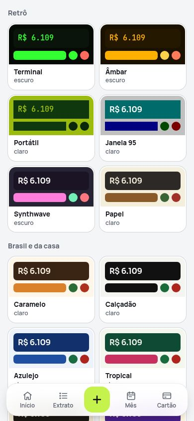<br><b>Temas</b><br><sub>Prévia em cada card</sub></td>
    <td align="center">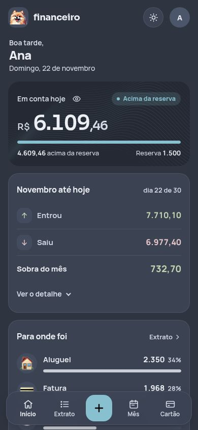<br><b>Nord</b><br><sub>Um dos consagrados</sub></td>
    <td align="center">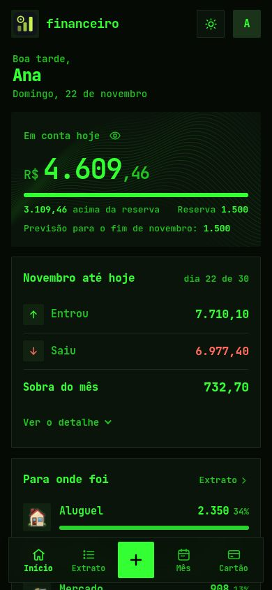<br><b>Terminal</b><br><sub>Retrô, com fonte própria</sub></td>
    <td align="center">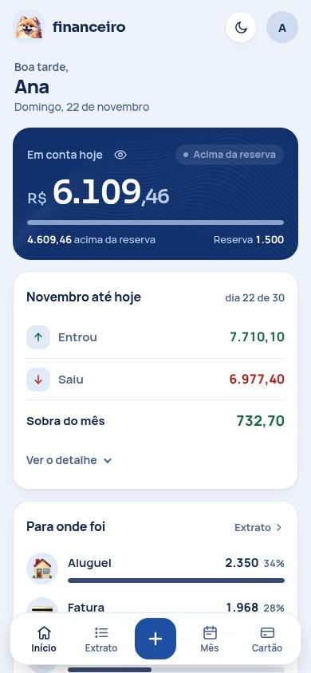<br><b>Azulejo</b><br><sub>Brasil e da casa</sub></td>
  </tr>
</table>

<details>
<summary><b>Temas, no computador</b></summary>
<br>
<picture>
  <source media="(prefers-color-scheme: dark)" srcset="docs/img/pc-temas-escuro.jpg">
  
</picture>
</details>

<details>
<summary><b>Wishlist, no computador</b></summary>
<br>
<picture>
  <source media="(prefers-color-scheme: dark)" srcset="docs/img/pc-wishlist-escuro.jpg">
  
</picture>
</details>

<details>
<summary><b>Empréstimo, no computador</b></summary>
<br>
<picture>
  <source media="(prefers-color-scheme: dark)" srcset="docs/img/pc-emprestimo-escuro.jpg">
  
</picture>
</details>

<details>
<summary><b>Anual, no computador</b></summary>
<br>
<picture>
  <source media="(prefers-color-scheme: dark)" srcset="docs/img/pc-anual-escuro.jpg">
  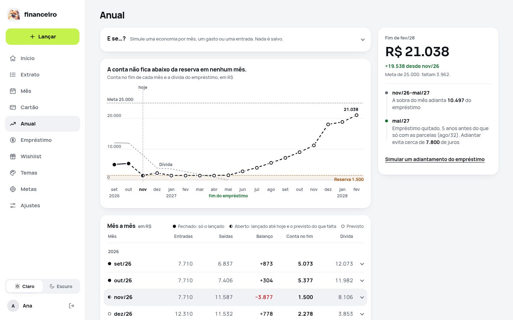
</picture>
</details>

| Tela | Responde | Rota |
|---|---|---|
| **Início** | Quanto tem na conta? Para onde foi o dinheiro? O saldo bate com o banco? | `/` |
| **Extrato** | O que foi lançado, e por quem? | `/lancamentos` |
| **Lançar (+)** | Registrar um gasto ou entrada | `/lancar` |
| **Mês** | Como este mês fecha? O que falta pagar? | `/mes` |
| **Cartão** | Quanto vem em cada fatura? | `/cartao` |
| **Anual** | Vamos ficar bem nos próximos meses? E se algo mudar? | `/futuro` |
| **Empréstimo** | Quanto falta? Vale adiantar? | `/emprestimo` |
| **Wishlist** | O que queremos comprar? Quando fica melhor comprar o 1º? | `/wishlist` |
| **Temas** | Com que cara quero o app? | `/temas` |
| **Metas** | Quanto queremos gastar por categoria? | `/meta` |
| **Ajustes** | Reserva, meta, contas recorrentes, aparelhos e senha | `/ajustes` |

## Como funciona

### A rotina do mês

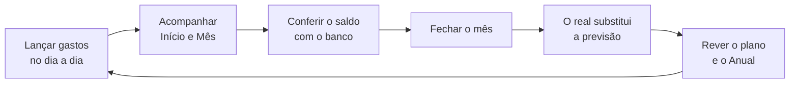

### De onde vem cada número

Cada mês está em um de três estados, e isso define o que entra no cálculo:

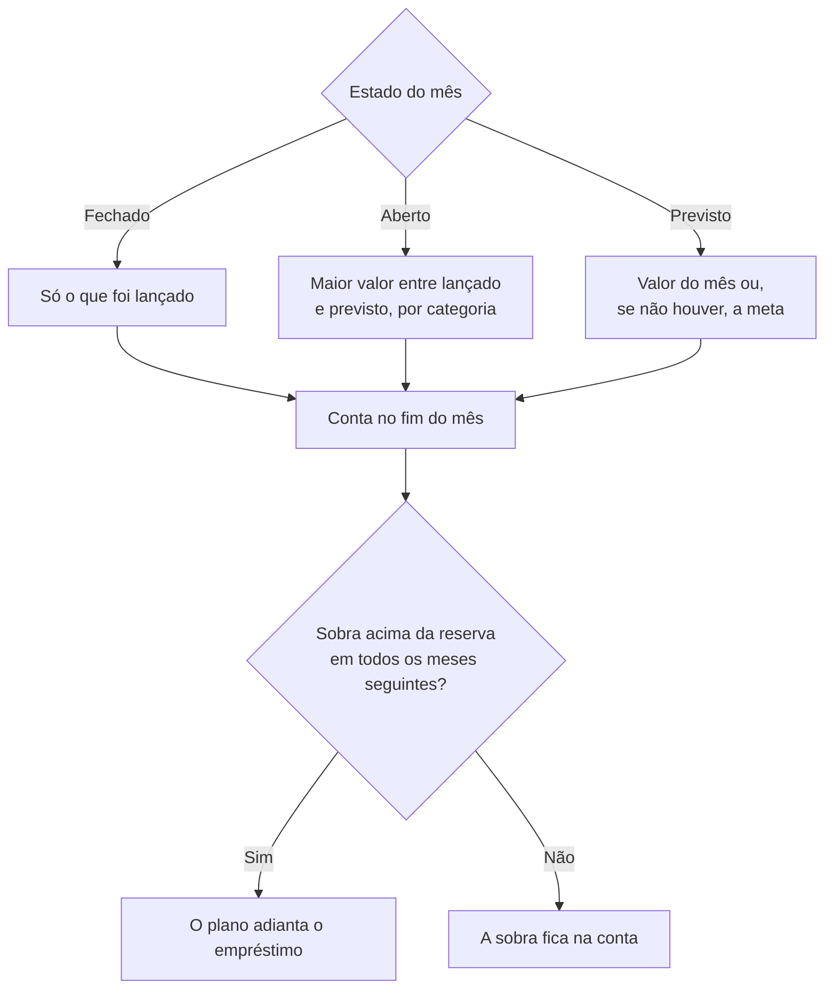

### Adiantar o empréstimo

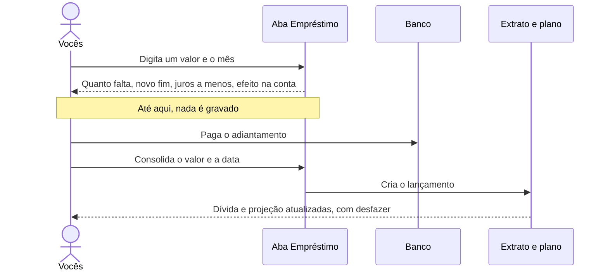

## Instalar

**Para experimentar**, com dados fictícios, em cerca de 10 minutos ([passo a passo](docs/INSTALACAO.md#caminho-rápido-para-experimentar)). Requer PHP 8.4+ e MySQL 8:

```sh
git clone git@github.com:HunterBDZ/Financeiro.git financeiro && cd financeiro
sudo mysql -e "CREATE DATABASE financeiro_demo CHARACTER SET utf8mb4 COLLATE utf8mb4_0900_ai_ci;
  CREATE USER 'financeiro_demo'@'localhost' IDENTIFIED BY 'demo1234';
  GRANT SELECT, INSERT, UPDATE, DELETE ON financeiro_demo.* TO 'financeiro_demo'@'localhost';"
sudo mysql financeiro_demo < database/schema.sql
cp config/.env.example config/.env
sed -i 's/^DB_NAME=.*/DB_NAME=financeiro_demo/; s/^DB_USER=.*/DB_USER=financeiro_demo/; s/^DB_PASS=.*/DB_PASS=demo1234/' config/.env
php database/instalar.php --demo
php -S 127.0.0.1:8099 -t public
```

Abra http://127.0.0.1:8099 e entre com `ana` / `demo1234`.

**Para usar de verdade**, siga o **[manual de instalação](docs/INSTALACAO.md)**: 10 passos com Apache, HTTPS, firewall e backup, além de como atualizar, restaurar e resolver problemas.

## Atualizar

Os sites não se atualizam sozinhos: o dono decide quando. Um comando baixa a última versão publicada, testa numa cópia do banco, faz backup e aplica. Se algo falhar, o site volta para a versão anterior.

```sh
sudo financeiro-atualizar --verificar   # há versão nova? o que muda?
sudo financeiro-atualizar               # atualiza
```

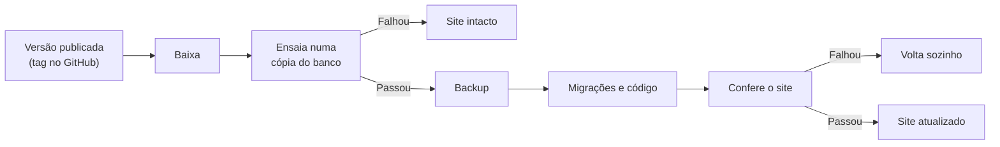

As mudanças de cada versão ficam no [`CHANGELOG.md`](CHANGELOG.md).

## Por dentro

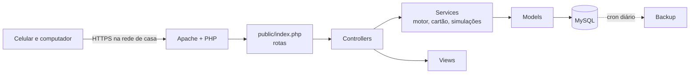

```text
public/      raiz do site: rotas e assets
src/         Controllers, Models, Services e Views
database/    schema.sql, instalar.php e migrations/
tests/       run.php, sem dependências
tools/       backup, publicação e sprite de ícones
docs/        manual de instalação, decisões e prints
```

O cálculo mora em `MotorFinanceiro::calcular()`, que é aritmética pura: as simulações rodam o motor de novo com outras opções, sem tocar no banco.

```sh
php tests/run.php    # roda numa transação desfeita no fim; os dados não mudam
```

### Segurança

- Senhas com bcrypt, consultas preparadas e CSRF em todo POST.
- Bloqueio de 10 minutos depois de 5 tentativas erradas de login.
- Sessão com `HttpOnly` e `SameSite=Strict`. "Lembrar este aparelho" dura 60 dias, troca o token a cada uso e pode ser revogado em Ajustes.
- CSP estrita, sem script inline nem CDN, com fontes auto-hospedadas.
- O usuário do banco só tem `SELECT`, `INSERT`, `UPDATE` e `DELETE`.
- Ao ler um link colado, o servidor só conecta em endereços públicos, confere cada redirecionamento e valida a foto pelo conteúdo.

### O que sai para a internet

Só a Wishlist usa a internet: o servidor abre os links que vocês colam e busca a cotação das moedas em serviços públicos. Nenhum dado financeiro é enviado.

### Acessibilidade

32 temas com contraste AA, entre eles dois de alto contraste e um para daltonismo. As telas passam por varredura do [axe](https://github.com/dequelabs/axe-core) em cada tema, e os testes medem o contraste das cores. Créditos e licenças das paletas: [`tools/temas/CREDITOS.md`](tools/temas/CREDITOS.md).

## Limitações

- Feito para o Brasil: só em português, com valores em reais e horário de Brasília.
- Uma conta, um cartão e um empréstimo.
- O plano tem um número fixo de meses, e o motor calcula por mês, não por dia.
- Os valores do empréstimo são estimativas até você informar o saldo do extrato. O que vale é o cálculo do banco.
- Não importa extratos automaticamente: os lançamentos são manuais.
- Algumas lojas bloqueiam a leitura do link: nesse caso, o item é preenchido à mão.
- A conversão de moedas usa a cotação comercial, sem IOF nem taxa do cartão. Em fim de semana e feriado, vale o último fechamento.
- Foi feito para a rede de casa, e não para ficar exposto na internet.

## Documentação

- **[Manual de instalação](docs/INSTALACAO.md):** instalar, atualizar, restaurar e resolver problemas.
- **[Como lançar uma versão](docs/LANCAR-VERSAO.md):** para quem desenvolve.
- **[Decisões e operação](docs/decisoes.md):** o porquê de cada regra. Leia antes de mudar uma delas.

## Status e licença

Em uso pelo casal, mantido por [@HunterBDZ](https://github.com/HunterBDZ). É um projeto pessoal, sem licença de uso definida.

O repositório é privado de propósito: `public/assets/img/icones.webp` contém emojis © Apple, só para uso pessoal, e o histórico traz nomes e valores reais. Veja `tools/icones/CREDITOS.md`. As fontes Manrope e Sora têm licença OFL. Antes de tornar o repositório público, é preciso trocar os ícones e limpar o histórico.
