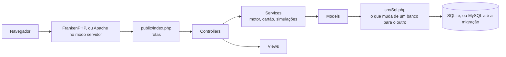

# Por dentro

Como o Financeiro é organizado, para quem quer entender ou mudar o código.

## Arquitetura



## Pastas

```text
public/      raiz do site: rotas e assets
src/         Controllers, Models, Services e Views
database/    schema.sqlite.sql, schema.sql, instalar.php, migrations/, migrations-sqlite/ e imagens da demonstração
packaging/   pacotes de Linux, Windows e Mac, gerente do programa, php.ini, Caddyfile, entrada do Docker e o empacotador
tests/       run.php, conferencia.php, regras.php e sistema.php, sem dependências; navegador/, com Playwright, só para desenvolver
tools/       backup, atualização, importador e comparador de bancos, sprite de ícones e outros geradores
docs/        manual de instalação, decisões e prints
```

## Partida

`src/bootstrap.php` roda em toda página, nesta ordem:

1. `Paths` descobre onde estão os dados: `FIN_DADOS`, `config/.env` ou a pasta do sistema (`%LOCALAPPDATA%\Financeiro`, `~/Library/Application Support/Financeiro` ou `~/.local/share/financeiro`).
2. `Preflight` confere PHP, extensões e pasta gravável. Se faltar algo, mostra uma tela clara.
3. `Primeira` cria o que falta na primeira execução: pasta, `config.env` e banco. O arquivo do banco só aparece pronto.
4. `Rede` confere o `Host`. A sessão e o log vão para a pasta de dados, quando ela existe.

## Backup, atualização e rede

- **`Backup`:** `VACUUM INTO` numa pasta `backups` da pasta de dados. A cópia do dia sai na primeira página do dia. Restaurar leva a cópia à versão atual e troca as linhas numa transação só, sem mexer no arquivo aberto.
- **`Migrador`:** `database/migrations-sqlite`, ao atualizar e ao abrir um pacote novo. Banco novo nasce com as migrações marcadas, porque o schema já as traz.
- **`Atualizacao`:** roda em processo próprio (`tools/atualizar.php`) e grava o andamento em `atualizacao/estado.json`. A troca é por `rename` da pasta `app`, então só vale no pacote. `Manutencao` segura as páginas enquanto o banco e o programa mudam. O FrankenPHP fica de fora da troca: `Atualizacao::programa` compara o `programa.json` do pacote e o PHP que roda com o `"programa"` do manifesto, e a tela avisa quando é hora de instalar o pacote novo.
- **`Rede` e `QrCode`:** o programa reinicia ao ligar a rede, porque precisa ouvir em outro endereço. O app grava `ACESSO_REDE` e cria o arquivo `reiniciar`, que `packaging/linux/financeiro` olha a cada segundo.

O endereço do repositório, para o código, fica no arquivo `REPOSITORIO`. O `instalar.sh` e os documentos têm o endereço escrito, e um teste confere que batem.

## Dois bancos

`DB_DRIVER` escolhe o banco. Não escreva SQL de um banco só: use `Sql::agora()`, `Sql::aoRepetir()`, `Sql::posicao()` e os outros. Valem aspas simples em texto, `SUM` e `COALESCE` como sempre. Imagem vai com `PDO::PARAM_LOB`. Mudança de tabela entra em `database/schema.sql` e em `database/schema.sqlite.sql`.

```sh
php tools/importar-mysql.php --mysql=config/.env --destino=/pasta/financeiro.sqlite   # só lê o MySQL e confere tudo
php tools/comparar-bancos.php --a=/pasta/mysql --b=/pasta/sqlite                      # plano no centavo e HTML das telas
```

## Cálculo e testes

O cálculo mora em `MotorFinanceiro::calcular()`, que é aritmética pura: as simulações rodam o motor de novo com outras opções, sem tocar no banco.

```sh
php tests/run.php      # conferência, regras e sistema; os dados não mudam
php tests/regras.php   # só as regras, num banco que nasce e morre na hora
```

O atualizador roda `tests/run.php` numa cópia dos dados da pessoa, então ele separa duas coisas:

- **Conferência** (`tests/conferencia.php`): roda no banco de `config/.env` ou, com `FIN_DADOS`, no dessa pasta. Só confere o que vale para qualquer casa, em qualquer data, idioma, moeda e fuso: as telas abrem sem erro, todo mês fechado fecha com o extrato, o Início bate com o banco, as traduções estão completas. Não supõe nada sobre os dados: mês sem lançamento, sem cartão, sem empréstimo, mês atual já fechado.
- **Regras** (`tests/regras.php`): tudo o que precisa de dados conhecidos. Rodam em processo próprio, num banco de demonstração criado numa pasta temporária, com o relógio parado em 22/11/2026 15:30. Uma segunda passada, às 23:50 do último dia do mês, repete o que olha a data de hoje e roda a conferência sobre a demonstração. A pasta some no fim, mesmo se algo falhar.
- **Sistema** (`tests/sistema.php`): backup, restauração, migrações e atualização, também num banco descartável.

Tudo tem de passar nos dois bancos. Com `FIN_REGRAS_DRIVER=mysql`, as regras criam e apagam um banco MySQL próprio, com o usuário de `FIN_REGRAS_DB_USER`, `FIN_REGRAS_DB_PASS` e `FIN_REGRAS_DB_HOST`, como faz o CI. Para desenvolver, prepare um banco de demonstração, como em [Como contribuir](../CONTRIBUTING.md#rodar-localmente).

## Relógio

Toda regra que pergunta que dia é hoje usa `Financeiro\Relogio` (`hoje()`, `mes()`, `agora()`), no fuso do site, e nunca `date()` ou `time()` direto. O banco acompanha: `agora_local()` do SQLite vem dele, e no MySQL a conexão recebe `SET timestamp`.

`FIN_RELOGIO='2026-11-22 15:30:00'` para o relógio nessa hora, no fuso do site, e ele não anda. Só vale na linha de comando e no `php -S`: os testes usam assim, e um teste no navegador pode usar também. Nas páginas servidas pelo Apache ou pelo FrankenPHP, a variável é ignorada.

Continuam na hora da máquina, de propósito: nomes e rotação dos backups, a cópia do dia, a validade de cookies e da manutenção, travas, esperas e o estado da atualização. Nesses casos, o que importa é o tempo que passou de verdade.

Os testes de navegador, em `tests/navegador`, abrem as telas no Chromium e no Firefox com um banco de demonstração novo e reprovam qualquer erro de JavaScript. Veja [Como contribuir](../CONTRIBUTING.md#testes-de-navegador).

## Acessibilidade

32 temas com contraste AA, entre eles dois de alto contraste e um para daltonismo. As telas passam por varredura do [axe](https://github.com/dequelabs/axe-core) em cada tema, e os testes medem o contraste das cores. Créditos e licenças das paletas: [`tools/temas/CREDITOS.md`](../tools/temas/CREDITOS.md).
