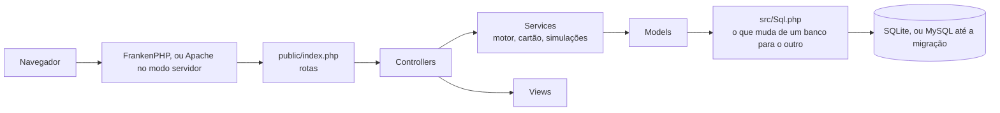

# Por dentro

Como o Financeiro é organizado, para quem quer entender ou mudar o código.

## Arquitetura



## Pastas

```text
public/      raiz do site: rotas e assets
src/         Controllers, Models, Services e Views
database/    schema.sqlite.sql, schema.sql, instalar.php, migrations/ e imagens da demonstração
packaging/   php.ini e Caddyfile levados junto com o programa
tests/       run.php, sem dependências
tools/       backup, atualização, importador e comparador de bancos, sprite de ícones e outros geradores
docs/        manual de instalação, decisões e prints
```

## Partida

`src/bootstrap.php` roda em toda página, nesta ordem:

1. `Paths` descobre onde estão os dados: `FIN_DADOS`, `config/.env` ou a pasta do sistema (`%LOCALAPPDATA%\Financeiro`, `~/Library/Application Support/Financeiro` ou `~/.local/share/financeiro`).
2. `Preflight` confere PHP, extensões e pasta gravável. Se faltar algo, mostra uma tela clara.
3. `Primeira` cria o que falta na primeira execução: pasta, `config.env` e banco. O arquivo do banco só aparece pronto.
4. `Rede` confere o `Host`. A sessão e o log vão para a pasta de dados, quando ela existe.

## Dois bancos

`DB_DRIVER` escolhe o banco. Não escreva SQL de um banco só: use `Sql::agora()`, `Sql::aoRepetir()`, `Sql::posicao()` e os outros. Valem aspas simples em texto, `SUM` e `COALESCE` como sempre. Imagem vai com `PDO::PARAM_LOB`. Mudança de tabela entra em `database/schema.sql` e em `database/schema.sqlite.sql`.

```sh
php tools/importar-mysql.php --mysql=config/.env --destino=/pasta/financeiro.sqlite   # só lê o MySQL e confere tudo
php tools/comparar-bancos.php --a=/pasta/mysql --b=/pasta/sqlite                      # plano no centavo e HTML das telas
```

## Cálculo e testes

O cálculo mora em `MotorFinanceiro::calcular()`, que é aritmética pura: as simulações rodam o motor de novo com outras opções, sem tocar no banco.

```sh
php tests/run.php    # o que grava é desfeito no fim; os dados não mudam
```

Os testes usam o banco de `config/.env` ou, com `FIN_DADOS`, o dessa pasta, e têm de passar nos dois bancos. Para desenvolver, prepare um banco de demonstração, como em [Como contribuir](../CONTRIBUTING.md#rodar-localmente).

## Acessibilidade

32 temas com contraste AA, entre eles dois de alto contraste e um para daltonismo. As telas passam por varredura do [axe](https://github.com/dequelabs/axe-core) em cada tema, e os testes medem o contraste das cores. Créditos e licenças das paletas: [`tools/temas/CREDITOS.md`](../tools/temas/CREDITOS.md).
