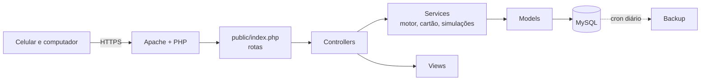

# Por dentro

Como o Financeiro é organizado, para quem quer entender ou mudar o código.

## Arquitetura



## Pastas

```text
public/      raiz do site: rotas e assets
src/         Controllers, Models, Services e Views
database/    schema.sql, instalar.php e migrations/
tests/       run.php, sem dependências
tools/       backup, publicação e sprite de ícones
docs/        manual de instalação, decisões e prints
```

## Cálculo e testes

O cálculo mora em `MotorFinanceiro::calcular()`, que é aritmética pura: as simulações rodam o motor de novo com outras opções, sem tocar no banco.

```sh
php tests/run.php    # roda numa transação desfeita no fim; os dados não mudam
```

## Acessibilidade

32 temas com contraste AA, entre eles dois de alto contraste e um para daltonismo. As telas passam por varredura do [axe](https://github.com/dequelabs/axe-core) em cada tema, e os testes medem o contraste das cores. Créditos e licenças das paletas: [`tools/temas/CREDITOS.md`](../tools/temas/CREDITOS.md).
